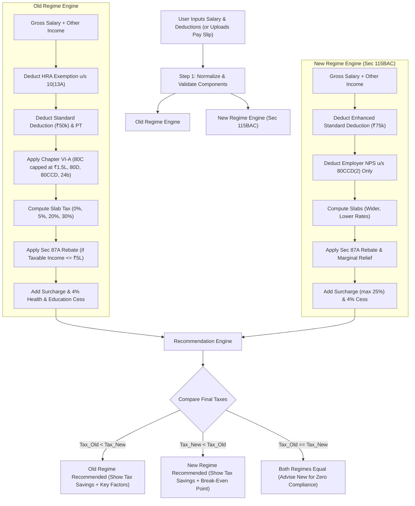

# How TaxWise Recommends the Tax Regime (Old vs. New)

This document provides a comprehensive technical and financial explanation of how **TaxWise** calculates, evaluates, and recommends whether an individual taxpayer should opt for the **Old Tax Regime** or the **New Tax Regime (Section 115BAC)**.

---

## 1. Core Recommendation Philosophy

Unlike basic online calculators that default to the New Tax Regime or make assumptions based solely on gross annual salary, **TaxWise uses a deterministic, parallel calculation engine**:

$$\text{Verdict} = \begin{cases} 
\mathbf{OLD\ REGIME\ RECOMMENDED} & \text{if } \text{Tax}_{\text{Old}} < \text{Tax}_{\text{New}} \\
\mathbf{NEW\ REGIME\ RECOMMENDED} & \text{if } \text{Tax}_{\text{New}} < \text{Tax}_{\text{Old}} \\
\mathbf{BOTH\ REGIMES\ EQUAL} & \text{if } \text{Tax}_{\text{Old}} = \text{Tax}_{\text{New}}
\end{cases}$$

$$\text{Annual Tax Savings} = |\text{Tax}_{\text{Old}} - \text{Tax}_{\text{New}}|$$

$$\text{Monthly In-Hand Difference} = \frac{\text{Annual Tax Savings}}{12}$$

Every recommendation is supported by:
1. **Actual rupee savings** (annual and monthly take-home boost).
2. **Itemized factor attribution** (e.g., how much HRA, 80C, or lower slab rates contributed to the outcome).
3. **Dynamic break-even deduction threshold** (the exact amount of deductions needed for the alternative regime to win).

---

## 2. Step-by-Step Mathematical Workflow

---

## 3. Detailed Engine Logic: Old Tax Regime

### Step 1: Gross Salary & Exemptions
- **Gross Salary** = $\text{Basic} + \text{HRA} + \text{Special Allowance} + \text{LTA} + \text{Bonus} + \text{Other Allowances} + \text{Taxable Employer PF}$.
- **HRA Exemption under Section 10(13A)**:
  The exemption is the **minimum** of:
  1. Actual HRA received from the employer.
  2. $50\%$ of Basic salary (for Metro cities: Delhi, Mumbai, Kolkata, Chennai) or $40\%$ (Non-Metro).
  3. Actual Rent paid minus $10\%$ of Basic salary.
  *(If rent paid $\le 10\%$ of basic salary, exemption is ₹0).*
- **Standard Deduction (Section 16(ia))**: Flat **₹50,000** (capped at salary).
- **Professional Tax (Section 16(iii))**: Fully deductible (typically ₹2,400 to ₹2,500/year).

### Step 2: Chapter VI-A Deductions
- **Section 80C**: Employee EPF + PPF + ELSS + LIC + Tuition Fees + Home loan principal.
  - **Double-Counting Protection**: Employee EPF is auto-credited; the combined sum with other 80C investments is strictly capped at **₹1,50,000**.
- **Section 80D (Health Insurance)**:
  - Self, spouse, children: Up to **₹25,000** (or **₹50,000** if Senior Citizen).
  - Parents: Additional **₹25,000** (or **₹50,000** if Senior Parents).
  - Preventive Health Checkup: Up to **₹5,000** within these limits.
- **Section 80CCD(1B)**: Additional voluntary self-NPS contribution up to **₹50,000**.
- **Section 80CCD(2)**: Employer NPS contribution up to **14% of Basic Salary**.
- **Section 24(b)**: Home loan interest for self-occupied property up to **₹2,00,000**.
- **Section 80E**: Higher education loan interest (no upper ceiling).
- **Section 80TTA**: Savings account interest deduction up to **₹10,000**.

### Step 3: Taxable Income & Slab Rates
$$\text{Taxable Income} = \text{Round}_{10}\Big(\text{Gross Total Income} - \text{Total Deductions}\Big)$$

- Slabs (Individuals < 60 years):
  - Up to ₹2,50,000: **0%**
  - ₹2,50,001 to ₹5,00,000: **5%**
  - ₹5,00,001 to ₹10,00,000: **20%**
  - Above ₹10,00,000: **30%**
- **Section 87A Rebate**: If taxable income $\le$ ₹5,00,000, 100% tax rebate applies (Max ₹12,500 $\rightarrow$ **₹0 Tax**).
- **Surcharge & Cess**: 4% Health & Education Cess applied on (Tax + Surcharge).

---

## 4. Detailed Engine Logic: New Tax Regime (Section 115BAC)

### Step 1: Exemptions & Deductions
- **Standard Deduction**:
  - **Budget 2024 & Budget 2025**: **₹75,000** (enhanced from ₹50,000).
  - **FY 2023-24**: ₹50,000.
- **Employer NPS (Section 80CCD(2))**: Up to **14% of Basic Salary** is allowed.
- **Disallowed in New Regime**:
  - ❌ HRA Exemption u/s 10(13A)
  - ❌ Section 80C (EPF, PPF, ELSS, etc.)
  - ❌ Section 80D (Medical insurance)
  - ❌ Section 24(b) (Home loan interest for self-occupied)
  - ❌ Section 80CCD(1B) (Self NPS)
  - ❌ Professional Tax u/s 16(iii)

### Step 2: Slabs & Section 87A Rebate

#### Under Budget 2025 (FY 2025-26 / AY 2026-27):
| Taxable Income Slab | Tax Rate | Cumulative Tax |
| :--- | :--- | :--- |
| **₹0 – ₹4,00,000** | Nil | ₹0 |
| **₹4,00,001 – ₹8,00,000** | 5% | ₹20,000 |
| **₹8,00,001 – ₹12,00,000** | 10% | ₹60,000 |
| **₹12,00,001 – ₹16,00,000** | 15% | ₹1,20,000 |
| **₹16,00,001 – ₹20,00,000** | 20% | ₹2,00,000 |
| **₹20,00,001 – ₹24,00,000** | 25% | ₹3,00,000 |
| **Above ₹24,00,000** | 30% | — |

- **Section 87A Rebate**: Taxable Income up to **₹12,00,000** is **100% Tax-Free** (Rebate up to ₹60,000).

#### Under Budget 2024 (FY 2024-25 / AY 2025-26):
| Taxable Income Slab | Tax Rate |
| :--- | :--- |
| **₹0 – ₹3,00,000** | Nil |
| **₹3,00,001 – ₹7,00,000** | 5% |
| **₹7,00,001 – ₹10,00,000** | 10% |
| **₹10,00,001 – ₹12,00,000** | 15% |
| **₹12,00,001 – ₹15,00,000** | 20% |
| **Above ₹15,00,000** | 30% |

- **Section 87A Rebate**: Taxable Income up to **₹7,00,000** is **100% Tax-Free**.
- **Section 87A Marginal Relief**: If taxable income slightly exceeds ₹7,00,000, tax payable is capped at:
  $$\text{Tax Payable} \le (\text{Taxable Income} - ₹7,00,000)$$

---

## 5. The Decision Rule & Break-Even Analysis

### What Decides Which Regime Wins?

The decision boils down to whether the **tax saved through deductions in the Old Regime** is greater than the **tax saved through the lower tax slabs and higher standard deduction of the New Regime**.

$$\text{Tax Advantage of Old Regime} = (\text{Total Deductions} \times \text{Old Slab Rate}) - \text{Slab Differential Benefit of New Regime}$$

### Break-Even Deduction Rule of Thumb

To make the Old Regime beneficial over the New Regime, an employee needs total deductions (Exemptions + 80C + 80D + 24b + NPS) exceeding a **break-even threshold**:

| Gross Salary Level | Break-Even Deductions Needed for Old Regime to Win |
| :--- | :--- |
| **Up to ₹7.5 LPA** | **New Regime is almost always better** (Zero tax under 87A). |
| **₹10.0 LPA** | Need approx. **₹2,62,500+** in total deductions. |
| **₹12.0 LPA** | Need approx. **₹3,12,500+** in total deductions. |
| **₹15.0 LPA** | Need approx. **₹3,75,000 to ₹4,25,000+** in total deductions. |
| **₹20.0 LPA+** | Need approx. **₹4,50,000+** (HRA + 80C + 80D + ₹2L Home Loan Interest). |

### Binary Search Break-Even Calculation in Code
In `src/lib/tax/recommendation-engine.ts`, when the New Regime wins, TaxWise runs an automated binary search simulation to tell the user:

> *"At your current salary of ₹X, you would need at least ₹Y in total deductions (such as additional rent receipts or home loan interest) for the Old Regime to become more beneficial."*

---

## 6. How the 4 Sample Profiles Illustrate the Engine

### Scenario 1: Fresher (₹5 LPA)
- **Gross**: ₹5,00,000
- **Deductions**: ₹20,000 in 80C, ₹10,000 health insurance.
- **Old Regime Tax**: ₹0 (Rebate u/s 87A on taxable income $\le$ ₹5L).
- **New Regime Tax**: ₹0 (Rebate u/s 87A on taxable income $\le$ ₹7L/₹12L).
- **Recommendation**: **EQUAL / NEW REGIME**
- **Reason**: Both yield ₹0 tax, but the New Regime requires zero documentation, receipts, or submission of investment proofs to the employer HR.

---

### Scenario 2: Mid-Level Product Manager (₹10.5 LPA)
- **Gross**: ₹10,50,000
- **Deductions Claimed**:
  - HRA Rent Paid: ₹18,000/month in Metro (Bengaluru/Mumbai) $\rightarrow$ **₹1.75L HRA exemption**.
  - Section 80C: Employee EPF (₹54k) + ELSS (₹100k) = **₹1.50L cap**.
  - Section 80D: Self (₹22k) + Senior Parents (₹25k) = **₹47,000**.
  - Section 80CCD(1B): Self NPS = **₹50,000**.
  - Total Deductions & Exemptions = **~₹4.72 Lakhs**.
- **Tax under Old Regime**: **~₹43,800**
- **Tax under New Regime**: **~₹62,400**
- **Recommendation**: **OLD TAX REGIME RECOMMENDED**
- **Savings**: **Saves ~₹18,600/year (~₹1,550/month)**.
- **Reason**: The combination of high metro HRA exemption and full utilization of 80C + 80D + NPS significantly reduces taxable income below the 20% slab.

---

### Scenario 3: Executive / Senior Lead (₹15 LPA – Budget 2025 Case)
- **Gross**: ₹15,00,000
- **Deductions Claimed**: ₹1.5L 80C + ₹50k 80D + ₹50k NPS = **₹2,50,000**. (No rent paid).
- **Calculation**:
  - **New Regime**:
    - Taxable Income: ₹15,00,000 - ₹75,000 = **₹14,25,000**
    - Slab Tax: 0 (0-4L) + 20,000 (4-8L) + 40,000 (8-12L) + 33,750 (12-14.25L) = **₹93,750**
    - 4% Cess: **₹3,750**
    - Total Tax: **₹97,500**
  - **Old Regime**:
    - Taxable Income: ₹15,00,000 - ₹50,000 - ₹2,50,000 = **₹12,00,000**
    - Slab Tax: 0 (0-2.5L) + 12,500 (2.5-5L) + 1,00,000 (5-10L) + 60,000 (10-12L) = **₹1,72,500**
    - 4% Cess: **₹6,900**
    - Total Tax: **₹1,79,400**
- **Recommendation**: **NEW TAX REGIME RECOMMENDED**
- **Savings**: **Saves ₹81,900/year (₹6,825/month)**.
- **Reason**: Moderate deductions of ₹2.5L are not enough to bridge the gap against the New Regime's wider 5%, 10%, and 15% slabs.

---

### Scenario 4: Homeowner with Loan (₹15 LPA)
- **Gross**: ₹15,00,000
- **Deductions Claimed**:
  - Section 24(b) Home Loan Interest: **₹2,00,000**.
  - Section 80C: Principal repayment + EPF = **₹1,50,000**.
  - Section 80D: Self + Senior Parents = **₹75,000**.
  - Section 80CCD(1B): NPS = **₹50,000**.
  - Total Deductions & Exemptions: **₹5,25,000**.
- **Tax under Old Regime**: **~₹98,800**
- **Tax under New Regime**: **~₹1,35,200**
- **Recommendation**: **OLD TAX REGIME RECOMMENDED**
- **Savings**: **Saves ~₹36,400/year**.
- **Reason**: Section 24(b) ₹2 Lakh home loan interest cannot be claimed in the New Regime. When combined with 80C and 80D, Old Regime wins decisively.

---

## 7. Summary Comparison Table

| Feature / Deduction | Old Tax Regime | New Tax Regime (Budget 2024 / 2025) |
| :--- | :--- | :--- |
| **Standard Deduction** | ₹50,000 | **₹75,000** |
| **HRA Exemption** | Allowed u/s 10(13A) | ❌ Not Allowed |
| **Section 80C (PPF, ELSS, EPF)** | Up to ₹1,50,000 | ❌ Not Allowed |
| **Section 80D (Health Insurance)** | Up to ₹1,00,000 (Self + Parents) | ❌ Not Allowed |
| **Section 24(b) (Home Loan Interest)** | Up to ₹2,00,000 (Self-occupied) | ❌ Not Allowed |
| **Section 80CCD(1B) (Self NPS)** | Up to ₹50,000 | ❌ Not Allowed |
| **Section 80CCD(2) (Employer NPS)** | Allowed (up to 14% of Basic) | **Allowed (up to 14% of Basic)** |
| **Section 87A Zero Tax Ceiling** | Taxable income up to **₹5,00,000** | Taxable income up to **₹7,00,000 / ₹12,00,000** |
| **Marginal Relief on 87A** | Limited | **Full marginal relief guaranteed** |
| **Paperwork & Proof Submission** | High (Rent receipts, PAN, LIC slips) | **Zero paperwork** |
